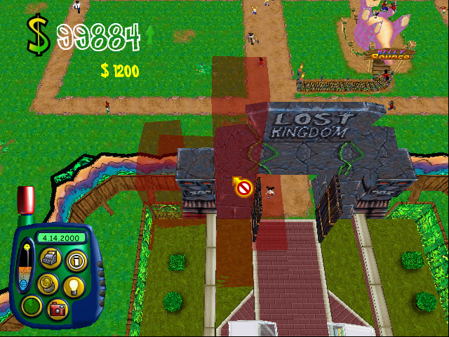
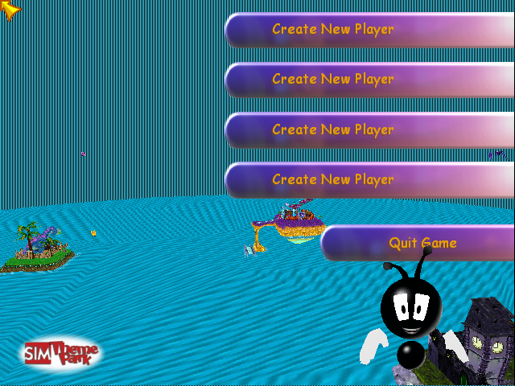
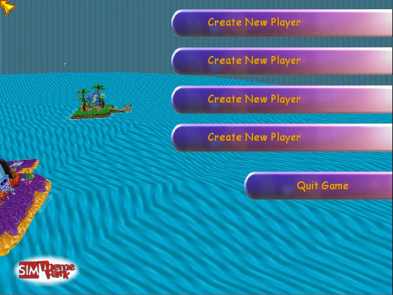

# Sim Theme Park — Static Recompilation

Static recompilation of **Sim Theme Park** (Bullfrog / Electronic Arts, 1999;
*Theme Park World* outside North America) from its shipping Windows executable,
the US Gold Edition 2.0 `tp.exe`, to native C. No emulator and no wrapper DLLs:
the game's own code and its own MMX software renderer, recompiled, calling
Windows directly. The 1994 [Theme Park recomp](https://github.com/sp00nznet/themepark-recomp)
is a DOS game on another engine; nothing of its code carries over.

Built on the [pcrecomp](https://github.com/sp00nznet/pcrecomp) toolchain, on
its `main` branch, and following
its house style: layout, command line, headless mode.

## Getting Started

You need **your own installed copy of Sim Theme Park** (US Gold Edition 2.0;
the folder with `tp.exe` and `data\`). Nothing from the game is in this
repository or downloaded for you; everything is built on your machine from
your copy. If your copy carries a DirectDraw wrapper such as dgVoodoo
(`DDraw.dll`, `D3DImm.dll` in the game folder), move it aside: the recompiled
game uses Windows' own DirectDraw.

### The setup scripts

1. Download this repository (the green **Code** button, then **Download
   ZIP**) and unzip it somewhere with 3 GB free.
2. Windows: double-click **`Setup.cmd`**. Linux and macOS are not supported
   yet; `./setup.sh` says so and stops.
3. Play with **`Sim Theme Park`** in that folder.

The script checks for Python 3.10+, `pefile` and `capstone`, the pcrecomp
toolkit (cloned beside this folder from `main` if it is
missing) and the Visual Studio 2022 C++ compiler, and asks before installing
any of them. It asks where the game is (`Setup.cmd -GameDir "C:\Program Files
(x86)\SimTheme Park"` skips the question, `-Yes` answers yes), then catalogs,
lifts and builds; a rerun skips finished steps, and the details go to
`setup.log`. Building by hand and the command line are in
**[docs/building.md](docs/building.md)**.

## Status

**v0.1.0-dev, early.** In game: a park opens and runs (Instant Action, Lost
Kingdom), driven headless by mouse and keyboard. Not yet played: no rides
built, no saving.

| Stage | State |
|---|---|
| Version recompiled | US Gold Edition 2.0 `tp.exe` (without SafeDisc); the official patch 2 (March 2000) is older than the Gold Edition and already in it |
| Lift | 1 module, 38,235 functions, 0 errors, 210 instructions as no-ops (3DNow! paths); pcrecomp `rtti.py` + `disasm32.py` + `drive32`, no IDA |
| Host (`build\simthemepark.exe`, 32-bit, `native32`) | 367 imports bound, 0 unresolved; third-party DLLs (QMixer, `wea*`, `usp11`) load natively |
| Start-up: registry, language files, DirectSound, DirectInput | works (registry from `work\registry.reg`) |
| Renderer | the game's own MMX software renderer, windowed 640x480 at the desktop's depth; about 7 frames a second with the generated C at `/Od`; the `/O2` build draws no 3D |
| Intro, profile screen | the profile screen and the island fly-by draw; the sky shows vertical stripes |
| Menus, a park opening | **works**: Create New Player, a typed name, Instant Action, the Lost Kingdom island, and the park runs (visitors, the calendar, money) |
| Sound | DirectSound and QMixer are the real ones; `--headless` runs are muted |
| Headless (`--headless --record out.mp4`) | works: a private desktop, frames from the presented surface, ffmpeg recording |
| Setup.cmd | tested from a fresh clone (2026-11-12): toolkit check, catalog, lift, build and shortcut, then the dry run binds with 0 unresolved |
| Linux, macOS | not yet (`setup.sh` says so) |
| Conformance harness | none yet; the dry run and a scripted run into a park ([docs/testing.md](docs/testing.md)) |

## Screenshots

Real output of `build\simthemepark.exe --headless --run --shot ...`:

| | |
|---|---|
|  |  |

## Documentation

- [docs/building.md](docs/building.md): building by hand, the command line, build options
- [docs/testing.md](docs/testing.md): the dry run and the scripted run into a park
- [docs/bringup.md](docs/bringup.md): every wall so far and its fix
- [ROADMAP.md](ROADMAP.md), [CHANGELOG.md](CHANGELOG.md), [CONTRIBUTING.md](CONTRIBUTING.md)

## Contributors

See **[CONTRIBUTORS.md](CONTRIBUTORS.md)** for who did what. Thank you, all of
you.

## License

MIT for this repository's own code ([LICENSE](LICENSE)). Sim Theme Park /
Theme Park World is © Bullfrog Productions and Electronic Arts; none of its
files, and nothing generated from them, is in this repository
([NOTICE.md](NOTICE.md)).
